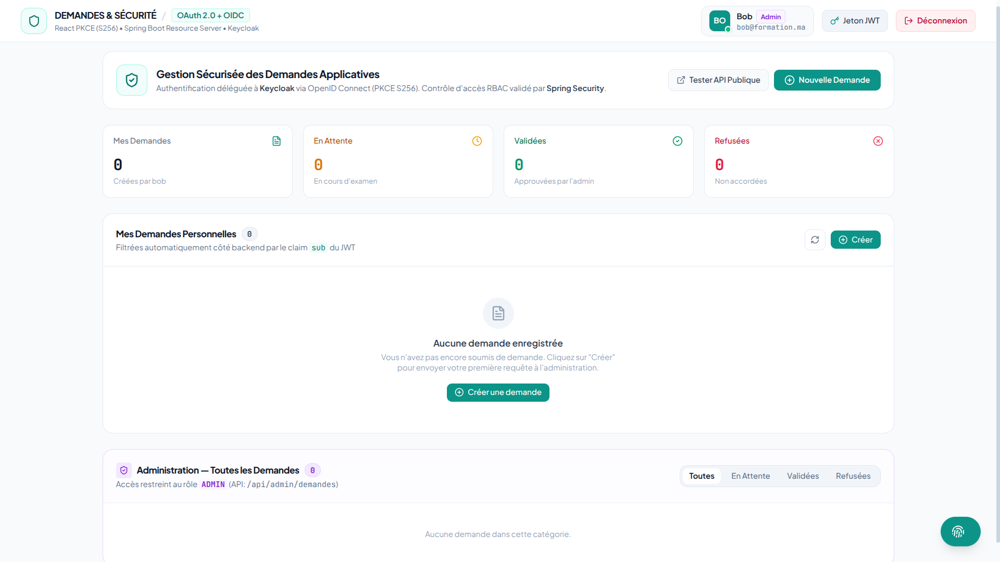
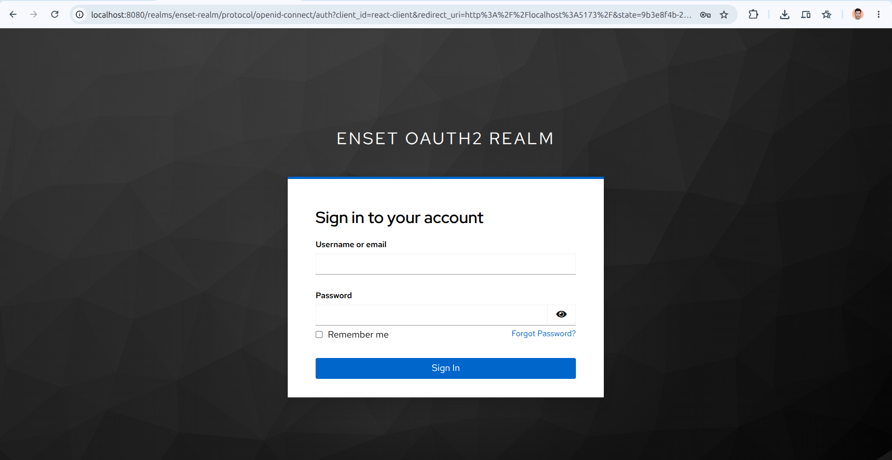
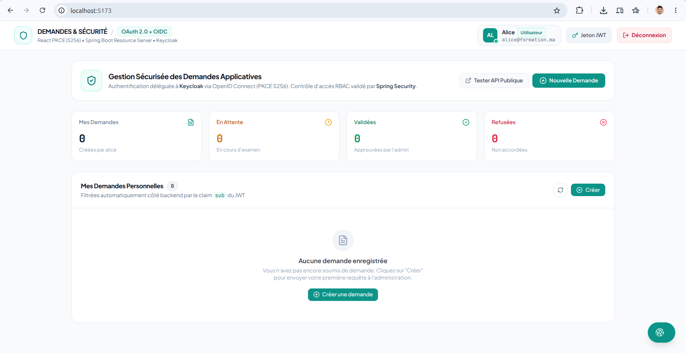
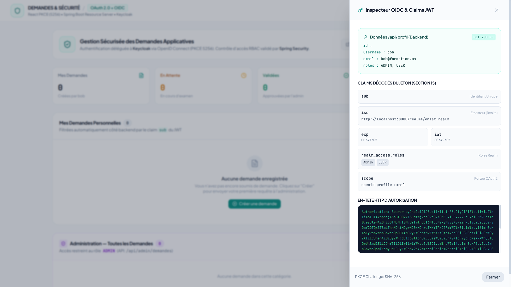
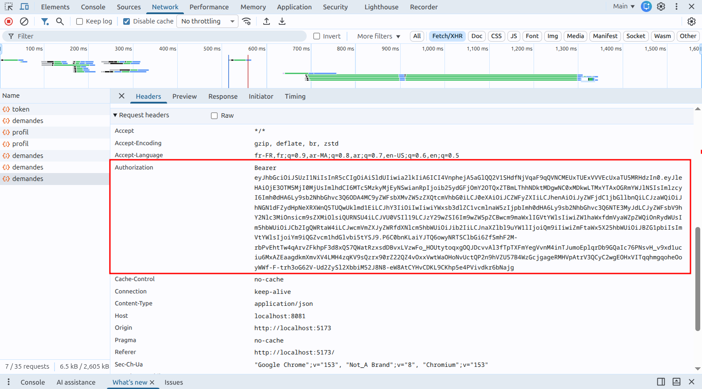
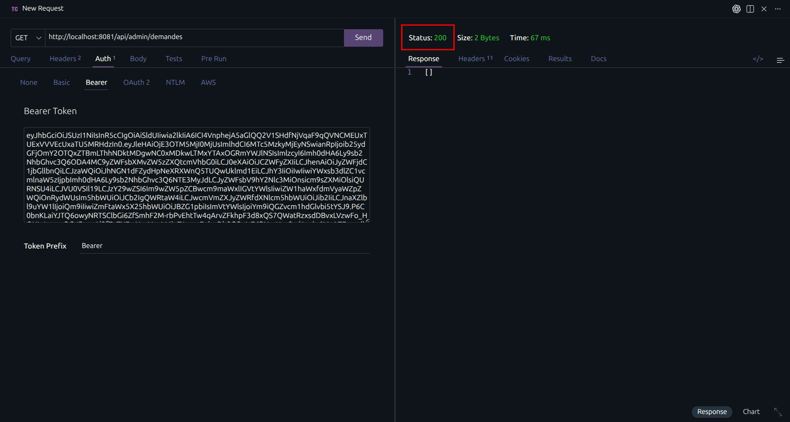
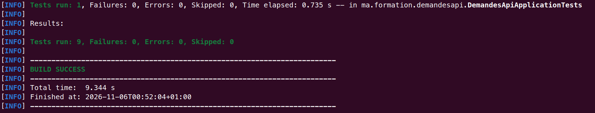
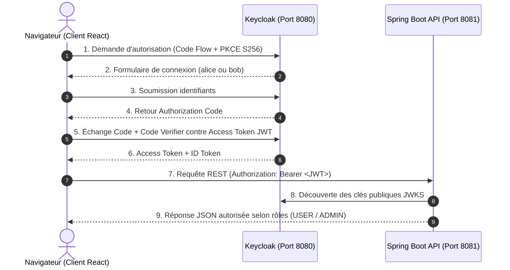

<div align="center">
  <!-- En-tête créatif -->
  

  <!-- Animation texte ciblant "Ce que fait le projet" et "Pourquoi c'est utile" -->
  

  <br/>

  <!-- Badges technologiques et GitHub -->
  <p>
    
    
    
    
    
    
  </p>
</div>

---

## À propos du projet

**Secure Request Management** est une solution full-stack complète d'authentification et de contrôle d'accès distribué basée sur les standards **OAuth 2.0** et **OpenID Connect (OIDC)**. Développée dans le cadre de l'atelier pratique de sécurité des systèmes distribués, elle illustre la séparation des responsabilités entre un **Serveur d'Identité centralisé (Keycloak)**, un **Resource Server (Spring Boot 3)** et une **Application Web monopage (React / Vite)**.

L'application implémente le flux recommandé pour les applications publiques s'exécutant dans le navigateur : **Authorization Code avec PKCE (Proof Key for Code Exchange avec SHA-256)**, garantissant qu'aucun secret client n'est exposé.

> [!NOTE]
> Pour une vue exhaustive des protocoles, des mécanismes cryptographiques et des schémas d'interaction, consultez la [documentation d'architecture détaillée](docs/ARCHITECTURE.md), la [spécification d'API REST](docs/API.md) ainsi que la [galerie complète des 20 captures d'écran](docs/SCREENSHOTS.md).

<!-- APERÇU VISUEL (1 Capture Principale + Dropdown 6 Captures en col-2) -->
### Aperçu en action

<div align="center">
  
  <p><em>Figure 1 : Interface Bento Grid avec gestion des demandes, validation RBAC et profil administrateur</em></p>
</div>

<details>
  <summary><b>Voir plus de captures d'écran (Flux OIDC, Sécurité & Tests)</b></summary>
  <br/>

  <table width="100%">
    <tr>
      <td width="50%" align="center">
        <b>1. Redirection & Mire de Connexion Keycloak</b><br/><br/>
        
        <br/><em>Flux Authorization Code avec PKCE (S256)</em>
      </td>
      <td width="50%" align="center">
        <b>2. Dashboard Utilisateur Standard (Alice)</b><br/><br/>
        
        <br/><em>Création de demande et cloisonnement strict (panneau admin absent)</em>
      </td>
    </tr>
    <tr>
      <td width="50%" align="center">
        <b>3. Inspecteur OIDC & Claims JWT Décodés</b><br/><br/>
        
        <br/><em>Visualisation en temps réel de <code>sub</code>, <code>iss</code>, rôles et endpoint <code>/api/profil</code></em>
      </td>
      <td width="50%" align="center">
        <b>4. Transmission de l'Access Token (DevTools)</b><br/><br/>
        
        <br/><em>En-tête HTTP <code>Authorization: Bearer &lt;token&gt;</code> transmis au Resource Server</em>
      </td>
    </tr>
    <tr>
      <td width="50%" align="center">
        <b>5. Validation Sécurité API dans Postman (RBAC)</b><br/><br/>
        
        <br/><em>Accès autorisé <code>200 OK</code> pour l'administrateur Bob (<code>403</code> pour Alice)</em>
      </td>
      <td width="50%" align="center">
        <b>6. Suite de 9 Tests Automatisés de Sécurité</b><br/><br/>
        
        <br/><em>Validation JUnit/MockMvc des scénarios 200, 400, 401 et 403 (<code>BUILD SUCCESS</code>)</em>
      </td>
    </tr>
  </table>

  <p align="center">
    <b><a href="docs/SCREENSHOTS.md">Accéder à la galerie complète des 20 captures d'écran détaillées et annotées →</a></b>
  </p>
</details>

---

## Pourquoi utiliser ce projet ?

- **Authentification Centralisée & Découplée :** Spring Boot ne manipule ni ne stocke plus aucun mot de passe. L'authentification est totalement déléguée à Keycloak.
- **Sécurité Naviguée Sans Secret (PKCE S256) :** Élimine le risque d'interception de jeton sur le client React public grâce à la vérification par clé de hachage SHA-256.
- **Contrôle d'Accès Fin par Rôles (RBAC) :**
  - **USER (`alice`) :** Création de demandes, consultation strictement cloisonnée de ses propres requêtes (filtrées par le claim `sub`).
  - **ADMIN (`bob`) :** Visualisation de toutes les demandes de l'organisation, approbation (`VALIDEE`) ou refus (`REFUSEE`).
- **Design System Clean Light UI :** Interface web moderne, bento grid, fenêtres modales avec flou givré, tiroir coulissant inspecteur de jeton JWT et micro-animations fluides.
- **Travail Supplémentaire Intégré :**
  - Fonctionnalité de refus de demande (`REFUSEE`) réservée à l'administrateur.
  - Endpoint de profil utilisateur (`/api/profil`) extrayant `sub`, `preferred_username`, `email` et `roles`.
  - Suite de 9 tests automatisés de sécurité Spring Security validant les codes 200, 400, 401 et 403.

---

## Stack Technique

| Composant | Technologie | Port | Description |
| :--- | :--- | :--- | :--- |
| **Identity Provider (IdP)** | Keycloak `26.8.1` | `8080` | Serveur d'autorisation & Realm `enset-realm` |
| **Resource Server** | Spring Boot `3.4.3` / Java 17 | `8081` | API REST avec Spring Security & JWT decoder |
| **Frontend SPA** | React `18` / Vite / Tailwind CSS | `5173` | Client public OIDC avec bibliothèque `keycloak-js` |
| **Conteneurisation** | Docker & Docker Compose | - | Déploiement et import automatique du Realm |

---

## Architecture et Flux Global



---

## Pour commencer

### Prérequis

Assurez-vous de disposer des outils suivants sur votre machine :

- **Docker & Docker Compose** (v24.0+)
- **Java JDK 17** (ou supérieur)
- **Node.js** (v18+ ou v20+) et **npm**
- **Maven** (inclus via le script wrapper `./mvnw`)

---

### Démarrage Rapide en 3 Étapes

#### 1. Démarrer le Serveur Keycloak

Le fichier `docker-compose.yml` pré-configure le Realm `enset-realm`, le client `react-client`, les rôles `USER`/`ADMIN` et les comptes `alice` et `bob` :

```bash
# Lancement de Keycloak
docker compose up -d

# Vérifier les logs
docker compose logs -f keycloak
```

> Keycloak sera prêt et accessible sur **http://localhost:8080** (Admin console : `admin` / `admin`).

#### 2. Démarrer le Backend Spring Boot

```bash
cd demandes-api
./mvnw spring-boot:run
```

> L'API démarre sur **http://localhost:8081**.
> Vous pouvez tester l'endpoint public immédiat : `curl http://localhost:8081/api/public` (retourne `200 OK`).
> Toute requête sur `http://localhost:8081/api/demandes` sans token retourne immédiatement `401 Unauthorized`.

#### 3. Démarrer le Frontend React

```bash
cd demandes-front
npm install
npm run dev
```

> Ouvrez **http://localhost:5173** dans votre navigateur. Vous serez automatiquement redirigé vers Keycloak pour vous authentifier !

---

## Comptes de Test Pré-configurés

| Utilisateur | Mot de passe | Rôles associés | Droits applicatifs |
| :--- | :--- | :--- | :--- |
| **`alice`** | `alice123` | `USER` | Créer une demande, consulter **ses propres** demandes. |
| **`bob`** | `bob123` | `USER`, `ADMIN` | Consulter **toutes** les demandes, valider (`VALIDEE`) ou refuser (`REFUSEE`). |

---

## Scénarios de Test et Validation de Sécurité

### 1. Test Alice (Utilisateur standard)
1. Connectez-vous avec `alice` / `alice123`.
2. Le prénom/identifiant d'Alice et son badge `Utilisateur` apparaissent en haut à droite.
3. Créez une demande en cliquant sur **"Nouvelle Demande"**.
4. La demande apparaît dans **"Mes Demandes"** avec le statut `EN_ATTENTE`.
5. La section **"Administration" est absente** de l'écran.

### 2. Test Bob (Administrateur)
1. Déconnectez-vous et connectez-vous avec `bob` / `bob123`.
2. Le badge `Admin` violet apparaît.
3. La section **"Administration — Toutes les Demandes"** est visible.
4. Bob peut cliquer sur **"Valider"** ou **"Refuser"** pour mettre à jour le statut en temps réel.

### 3. Test Inspecteur JWT & Claims OIDC
1. Cliquez sur le bouton flottant en bas à droite ou sur le bouton **"Jeton JWT"**.
2. Le tiroir latéral affiche :
   - Le claim `sub` (UUID du propriétaire).
   - L'émetteur `iss` (`http://localhost:8080/realms/enset-realm`).
   - Les rôles extraits `realm_access.roles`.
   - Les données en direct retournées par l'endpoint `/api/profil`.
   - L'en-tête complet `Authorization: Bearer <token>`.

### 4. Tests Automatisés de Sécurité Spring Boot

Une suite de tests automatisés vérifie tous les prérequis de sécurité sans dépendance externe :

```bash
cd demandes-api
./mvnw test
```

Résultat : **9/9 tests réussis** couvrant :
- Accès public sans jeton (`200 OK`)
- Rejet des requêtes non authentifiées (`401 Unauthorized`)
- Rejet d'un utilisateur `USER` accédant à l'administration (`403 Forbidden`)
- Succès d'un administrateur `ADMIN` modifiant les statuts (`200 OK`)
- Extraction correcte des données de profil (`/api/profil`)

---

## Structure du Projet

```text
secure-request-management/
├── docker-compose.yml              # Conteneur Keycloak avec import automatique
├── keycloak/
│   └── realm-export.json          # Configuration complète du realm, client et utilisateurs
├── demandes-api/                   # Backend Spring Boot 3.4 (Resource Server)
│   ├── pom.xml                     # Dépendances Maven (Web, Security, OAuth2 Resource Server)
│   ├── mvnw / mvnw.cmd             # Maven Wrapper
│   └── src/
│       ├── main/
│       │   ├── java/ma/formation/demandesapi/
│       │   │   ├── DemandesApiApplication.java
│       │   │   ├── SecurityConfig.java     # Configuration Spring Security & JWT Converter
│       │   │   └── DemandeController.java  # Endpoints REST (public, demandes, admin, profil)
│       │   └── resources/
│       │       └── application.properties  # Port 8081 et issuer-uri Keycloak
│       └── test/
│           └── java/ma/formation/demandesapi/
│               └── DemandeControllerSecurityTest.java  # 9 tests automatisés de sécurité
├── demandes-front/                 # Frontend React 18 / Vite (Clean Light UI)
│   ├── package.json
│   ├── vite.config.js              # Port 5173
│   ├── tailwind.config.js          # Design system, Bento Grid, animations
│   ├── src/
│   │   ├── index.css               # Scrollbars minimalistes et micro-animations
│   │   ├── keycloak.js             # Client Keycloak-js (PKCE S256)
│   │   ├── api.js                  # Helper Fetch avec auto updateToken et Bearer
│   │   ├── App.jsx                 # Interface complète avec rôles et drawer JWT
│   │   └── main.jsx                # Initialisation login-required & fallback
│   └── index.html
├── docs/
│   ├── ARCHITECTURE.md             # Conception, protocoles OIDC, diagrammes Mermaid
│   └── API.md                      # Spécification détaillée des requêtes & réponses
├── LICENSE                         # Licence MIT
└── README.md                       # Guide complet du projet
```

---

## Aide et Support

Vous avez une question sur l'implémentation ou l'architecture ?
- **Documentation technique :** Consultez [l'Architecture détaillée](docs/ARCHITECTURE.md), la [Spécification d'API REST](docs/API.md) et la [Galerie Complète des Captures d'Écran](docs/SCREENSHOTS.md).
- **Contact direct :** N'hésitez pas à me contacter directement via LinkedIn ou mon portfolio.

---

## Contribuer

1. **Forkez** le projet
2. Créez votre branche de fonctionnalité (`git checkout -b feature/NouvelleFonctionnalite`)
3. Commitez vos modifications (`git commit -m 'feat: Ajout de NouvelleFonctionnalite'`)
4. Pushez vers votre branche (`git push origin feature/NouvelleFonctionnalite`)
5. Ouvrez une **Pull Request**

---

## Auteur

<div align="center">

**Yazid ESSOKTANI**  
*Full-Stack Web & AI Developer*

[](https://www.essoktani.tech/)
[](https://www.linkedin.com/in/yazid-essoktani-337549251)
[](https://github.com/essoktani)

</div>

---

## Licence

Distribué sous la licence **MIT**. Consultez le fichier [`LICENSE`](LICENSE) pour plus d'informations.

