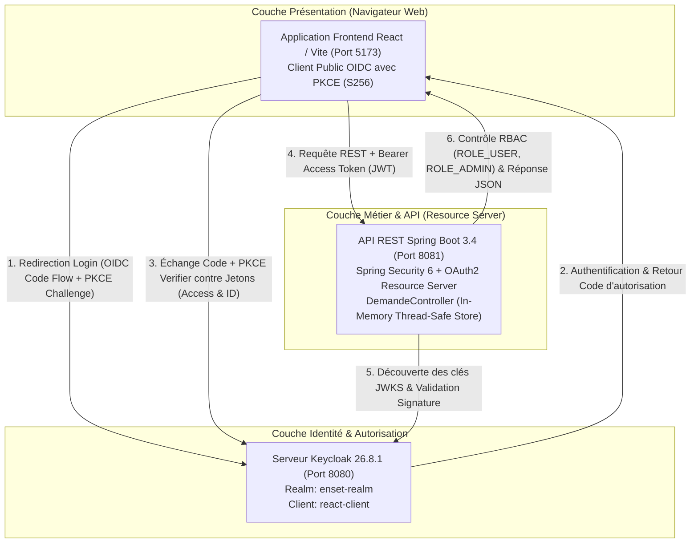
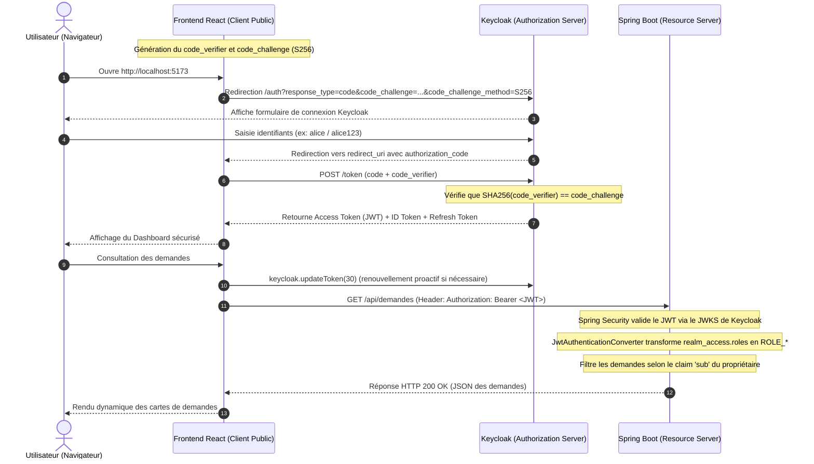

# Architecture du Système — Gestion Sécurisée des Demandes (OAuth 2.0 / OIDC)

> Ce document décrit l'architecture technique, les protocoles de sécurisation, les flux d'authentification et les choix de conception du projet **Secure Request Management**.

---

## 1. Vue d'ensemble (High-Level Design)

L'application repose sur une architecture distribuée moderne et découplée, séparant formellement le **Serveur d'Identité (Identity Provider / Authorization Server)**, le **Serveur de Ressources (Resource Server)** et le **Client Frontend Public (SPA)** :



---

## 2. Composants Principaux

| Composant | Technologie | Port | Rôle & Responsabilités |
| :--- | :--- | :--- | :--- |
| **Serveur d'Identité (IdP)** | Keycloak 26.8.1 | `8080` | Centralisation de l'authentification, gestion des utilisateurs (`alice`, `bob`), attribution des rôles de Realm (`USER`, `ADMIN`), émission et signature des jetons JWT (RS256). |
| **Resource Server (API)** | Spring Boot 3.4 / Java 17 | `8081` | Hébergement de l'API REST de gestion des demandes, validation cryptographique des Access Tokens JWT (signature, émetteur, expiration), extraction des claims `realm_access.roles` et application du contrôle d'accès strict (RBAC). |
| **Client Frontend (SPA)** | React 18 / Vite / Tailwind | `5173` | Application web monopage exécutée dans le navigateur (client public OAuth 2.0), gestion du cycle de vie de session via `keycloak-js`, flux Authorization Code avec PKCE, renouvellement automatique du jeton, interface Clean Light UI. |

---

## 3. Flux d'Authentification OAuth 2.0 avec PKCE (Sequence Diagram)

Les applications monopages (SPA) s'exécutant dans un navigateur ne peuvent pas conserver de secret client confidentiel. Le protocole **OAuth 2.0 Authorization Code Flow avec PKCE (Proof Key for Code Exchange - RFC 7636)** est utilisé pour éliminer tout risque d'interception du code d'autorisation :



---

## 4. Analyse et Mapping des Claims JWT

Le jeton Access Token émis par Keycloak contient les claims décodés suivants :

```json
{
  "exp": 1730768400,
  "iat": 1730764800,
  "jti": "d34f8a12-87ba-4fa5-bcde-92cf99a8b132",
  "iss": "http://localhost:8080/realms/enset-realm",
  "sub": "b8a9cf21-9988-4321-beef-123456789abc",
  "typ": "Bearer",
  "preferred_username": "alice",
  "email": "alice@formation.ma",
  "realm_access": {
    "roles": [
      "USER",
      "default-roles-enset-realm"
    ]
  },
  "scope": "openid email profile"
}
```

### Conversion des Rôles dans Spring Security

Dans Spring Security, les autorisations vérifiées par `.hasRole("ADMIN")` ou `.hasAnyRole("USER", "ADMIN")` exigent le préfixe conventionnel `ROLE_`. 

Le bean `JwtAuthenticationConverter` extrait la collection `realm_access.roles` et génère les autorités correspondantes :

```java
@Bean
JwtAuthenticationConverter jwtConverter() {
    JwtGrantedAuthoritiesConverter scopes = new JwtGrantedAuthoritiesConverter();
    JwtAuthenticationConverter converter = new JwtAuthenticationConverter();
    converter.setJwtGrantedAuthoritiesConverter(jwt -> {
        Collection<GrantedAuthority> result = new ArrayList<>(scopes.convert(jwt));
        Map<String, Object> access = jwt.getClaimAsMap("realm_access");
        if (access != null && access.get("roles") instanceof List<?> roles) {
            for (Object role : roles) {
                result.add(new SimpleGrantedAuthority("ROLE_" + role));
            }
        }
        return result;
    });
    return converter;
}
```

---

## 5. Matrice des Droits et Politiques de Sécurité (RBAC)

| Endpoint | Méthode HTTP | Rôle requis | Description | Comportement en cas de non-respect |
| :--- | :--- | :--- | :--- | :--- |
| `/api/public` | `GET` | *Public (Aucun)* | Test d'accessibilité sans authentification | `200 OK` |
| `/api/demandes` | `GET` | `USER` ou `ADMIN` | Liste des demandes propres à l'utilisateur connecté (`sub`) | `401 Unauthorized` si sans token |
| `/api/demandes` | `POST` | `USER` ou `ADMIN` | Création d'une demande assignée au `sub` authentifié | `401 Unauthorized` si sans token, `400` si objet vide |
| `/api/admin/demandes` | `GET` | `ADMIN` uniquement | Consultation de l'ensemble des demandes de la plateforme | `403 Forbidden` si rôle `USER` |
| `/api/admin/demandes/{id}` | `PATCH` | `ADMIN` uniquement | Validation (`VALIDEE`) ou refus (`REFUSEE`) d'une demande | `403 Forbidden` si rôle `USER` |
| `/api/profil` | `GET` | *Authentifié* | Retourne le profil extrait du JWT (`id`, `username`, `roles`) | `401 Unauthorized` si sans token |

---

## 6. Persistance et Isolation

- **Isolation des Demandes :** Les demandes sont stockées en mémoire volatile via une collection thread-safe `CopyOnWriteArrayList<Demande>`.
- **Intégrité du Propriétaire :** Le contrôleur n'accepte jamais d'identifiant propriétaire fourni par le client. L'attribut `owner` est obligatoirement instancié à partir de `jwt.getSubject()` garantissant l'impossibilité d'usurpation d'identité entre utilisateurs.

---
[⬅ Retour au README principal](../README.md)

